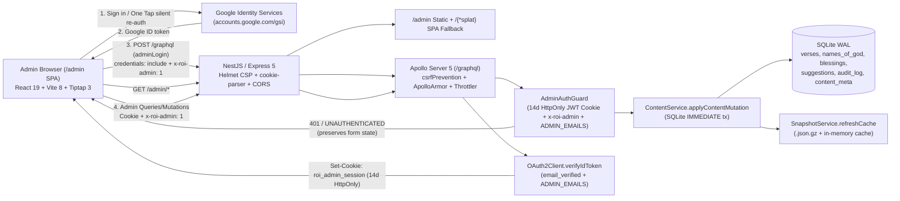

# Phase 3: Admin Panel & Moderation - Research

**Researched:** 2026-11-25
**Domain:** React 19 + Vite 8 + Tailwind 4 Admin SPA, Tiptap 3 Rich-Text & Chip Editor, Google Identity Services + 14-Day `httpOnly` Cookie Auth, NestJS 12 + Apollo Server 5 + Express 5 Single-Container Serving
**Confidence:** HIGH

---

## User Constraints

> Copied verbatim from [03-CONTEXT.md](file:///Users/andrew/Documents/Work/Dev/Projects/Personalss/روعي/.planning/phases/03-admin-panel-moderation/03-CONTEXT.md). Planner MUST honor all locked decisions.

### Decisions

#### Admin Auth, Allowlist & Session Lifecycle (`ADM-01`)
- **D-01:** **Env-only admin allowlist (`ADMIN_EMAILS`):** Configure authorized admin Google emails via a comma-separated `ADMIN_EMAILS` environment variable (case-insensitive trimmed compare; multiple admins supported concurrently). Backend verifies Google ID tokens via `google-auth-library` (`email_verified === true` and `email` in `ADMIN_EMAILS`) and rejects any non-allowlisted Google account. Adding or removing admins is an env update + restart in Dokploy.
- **D-02:** **14-day `httpOnly` cookie session (owner refinement of `ADM-01`):** — **Reversibility:** costly — changes backend admin session transport, cookie/CSRF settings, and admin SPA request credentials. On valid allowlisted Google Sign-In, the backend mints a signed `HttpOnly`, `SameSite=Lax`, `Secure` (in production) session cookie valid for **14 days**, requiring Google re-login after 14 days. Protect admin mutations against CSRF (e.g., Apollo CSRF prevention / required custom request header).
- **D-03:** **Mid-edit expiry protection:** If the admin session expires or returns `401` while editing content, attempt silent Google GIS re-authentication first and fall back to an in-page Google Sign-In modal without leaving the form or clearing state so unsaved edits are preserved.

#### Rich-Text Chip Editor, Validation & Live Preview (`ADM-02`..`ADM-06`)
- **D-04:** **Content-type editor & Markdown scope:**
  - **Verses (`verses`):** Plain text editor (no Markdown formatting marks) with the atomic, draggable `{الاسم}` name chip.
  - **Names of God (`names_of_god`) & Blessings (`blessings`):** Tiptap rich-text editor outputting the Markdown subset consumed by mobile (`react-native-marked`): **Bold, Italic, H2/H3 headings, Bullet list, Blockquote**, plus the atomic, draggable `{الاسم}` name chip (admin never sees raw `{الاسم}`; pasting `{الاسم}` converts into a chip).
- **D-05:** **Male/female toggle & non-destructive hiding (`ADM-03`):** When "same text for male/female" is ON, show a single `text` field; when OFF, show male (`text`) and female (`textFemale`) editors side by side and require both. Flipping the toggle back ON hides the female field non-destructively in client state during editing and persists `textFemale: null` only on Save.
- **D-06:** **Shared validation & one-sided name warning (`ADM-06`):** Validate all payloads with `personalizedTextSchema` from `@roi/shared` on both client and server (rejecting any `{…}` brace token other than `{الاسم}`). When both male and female texts exist and only one contains `{الاسم}`, show a **non-blocking amber warning banner** while allowing the admin to save intentionally.
- **D-07:** **Live preview (`ADM-05`):** Show a live mobile-accurate preview beside the editor with a test name input (including empty-name neutral fallback) and male/female gender toggle, powered directly by `personalize()` from `@roi/shared`.
- **D-08:** **Minimal v1 editor fields:** Keep content forms minimal — expose `ref` (verses), `title` (names/blessings), `verseRef` (optional for blessings), `text`, and `textFemale`; hide `tags` and `sortOrder` from the v1 admin editor UI and leave them `null`.

#### Suggestion Moderation Queue & Promotion Flow (`ADM-07`)
- **D-09:** **Edit-in-full-editor & atomic promotion:** Opening a suggestion loads its fields (`kind`, `title`/`ref`, `text`, `textFemale`, `verseRef`) into the full chip/Markdown/preview editor. Clicking **"Accept & Publish"** executes a single backend SQLite transaction that inserts the new public item into `verses` / `names_of_god` / `blessings`, updates the suggestion to `accepted`, increments `contentMeta.contentVersion`, writes an `audit_log` row, and calls `SnapshotService.refreshCache()`.
- **D-10:** **Queue tabs & rejection flow:** Provide `Pending`, `Accepted`, and `Rejected` tabs in the moderation queue. Rejecting a suggestion is a one-click action with an optional internal note (stored in `audit_log` / suggestion metadata), immediately removing the item from `Pending`.
- **D-11:** **Submitter context & concurrent moderation guard:** Show the submitter's `email`, submission timestamp, and historical counts (accepted / rejected / pending) while reviewing a suggestion. Guard Accept and Reject transitions on `status === 'pending'` inside the SQLite transaction so two admins working concurrently cannot accept or reject the same suggestion twice.

#### Admin UI Language, Catalog Management & Deployment (`ADM-02`, `BE-05`)
- **D-12:** **Bilingual UI toggle with locked RTL content fields:** Provide an Arabic / English UI language switcher for admin navigation, labels, and buttons with clean typography for both languages (`dir="rtl"` in Arabic mode, `dir="ltr"` in English mode using Tailwind logical utilities `ms-*`, `ps-*`, `text-start`). Keep all **content editor fields and live previews strictly `dir="rtl"`** regardless of the UI shell language so Arabic text and tashkeel never break.
- **D-13:** **Catalog search, soft-delete restore & audit log UI (`ADM-02`, `BE-05`):** Each content catalog list supports diacritic-insensitive search (`normalizeArabic()` / `matches()` from `@roi/shared`) and an **Active / Deleted** filter with a **Restore** action on soft-deleted items (clears `deletedAt`, bumps `contentVersion`, refreshes snapshots, writes `audit_log`). Include a read-only **Audit Log** page displaying `actorEmail`, `action`, `entityType`, `entityId`, `contentVersion`, summary, and timestamp.
- **D-14:** **Single-container deployment from NestJS (`admin/` served at `/admin`):** — **Reversibility:** costly — affects `Dockerfile`, NestJS static serving / SPA fallback, and origin/OAuth configuration. Build `admin/` as static assets served directly from the `backend/` NestJS container under `/admin` (same origin as the API, eliminating cross-site cookie issues on Dokploy). Preserve `ADMIN_ORIGINS` CORS support for local Vite development (`http://localhost:5173`).

### Claude's Discretion
- Admin session JWT signing secret env var naming (`ADMIN_JWT_SECRET`) and token payload claims, exact shadcn/ui component set and layout structure, `@tiptap/markdown` vs a hand-written ProseMirror-JSON ⇄ Markdown-subset serializer (if early-release `@tiptap/markdown` has RTL or chip round-trip issues), exact `audit_log` summary formatting, and whether optional rejection notes are stored only in `audit_log.summaryJson` or also as a nullable column on `suggestions`.

### Deferred Ideas
- None — discussion stayed within phase scope. (`tags` and `sortOrder` editor UI fields were intentionally omitted from v1 forms per `D-08` and remain `null` in the schema until needed.)

---

## Project Constraints (from CLAUDE.md)

Extracted from [.claude/CLAUDE.md](file:///Users/andrew/Documents/Work/Dev/Projects/Personalss/روعي/.claude/CLAUDE.md) and root workspace configuration:
- **Isolated Bun linker (`[VERIFIED: bunfig.toml:1-2]`):** `linker = "isolated"`. Every direct dependency of `admin/` or `backend/` MUST be declared in its own `package.json` (`admin/` uses Tailwind 4; `app/` stays on Tailwind 3; never hoist Tailwind 4 into `app/`).
- **Pinned `graphql` version (`[VERIFIED: .claude/CLAUDE.md:36]`, `[VERIFIED: backend/package.json:30]`):** Pin `"graphql": "16.15.0"` (or `^16.15.0`) in `admin/package.json` as well as `backend/` and `app/` — `graphql@17.1.0` is npm `latest` and is rejected by `graphql-request@7.4.0` (`peer graphql 14-16`) and `@apollo/server@5.5.2`.
- **Pinned `typescript` (`[VERIFIED: package.json:22]`):** Root pins `"typescript": "~6.0.3"`.
- **Vitest under real Node (`[VERIFIED: vitest.config.ts:1-13]`, `[VERIFIED: backend/vitest.config.ts:1-16]`):** Both root and backend Vitest configs throw if executed under Bun (`'bun' in process.versions`); always run tests via Node (`./node_modules/.bin/vitest` or `bun run test` which resolves `vitest` via Node shebang).
- **Node 24+ runtime (`[VERIFIED: backend/Dockerfile:3]`):** `node:24-slim` is the container base image (`react-router@8.5.3` requires `node >= 22.22.0`).
- **Backend ORM & Validation (`[VERIFIED: backend/src/common/zod-validation.pipe.ts:9-21]`):** Never use `class-validator` or `nestjs-zod` for request validation; use `ZodValidationPipe` with `@roi/shared` Zod 4 schemas.
- **Note on superseded CLAUDE.md §5 items:** `CLAUDE.md` §5 originally sketched a separate admin subdomain with in-memory Bearer JWT (`15-30 min`). `03-CONTEXT.md` **D-02** and **D-14** explicitly supersede this with a **14-day `httpOnly` cookie session + CSRF header** and **single-container static SPA served from NestJS at `/admin`**.

---

## Summary

Phase 3 spans two tightly coupled workspaces (`backend/` and `admin/`) plus a small root TypeScript/Dockerfile update. Much of the backend foundation already exists from Phase 2: `ContentService.applyContentMutation()` (`[VERIFIED: backend/src/content/content.service.ts:131-184]`) already encapsulates the exact synchronous `better-sqlite3` `IMMEDIATE` transaction pattern that bumps `contentMeta.contentVersion`, writes to `auditLog`, and refreshes the pre-built `.json.gz` snapshot cache via `SnapshotService.refreshCache()`. `GoogleAuthGuard` (`[VERIFIED: backend/src/common/google-auth.guard.ts:46-107]`) already demonstrates `OAuth2Client` ID-token verification with `email_verified === true`, and `@roi/shared` already exports `personalizedTextSchema`, `personalize()`, `NAME_TOKEN`, `normalizeArabic()`, `matches()`, `toArabicDigits()`, and `formatArabicDate()` (`[VERIFIED: shared/src/index.ts:1-51]`).

The two highest-risk technical seams in Phase 3 are:
1. **Tiptap 3 chip editor + Markdown subset round-trip (`ADM-04`..`ADM-06`):** `@tiptap/markdown@3.35.0` emits `&nbsp;` for consecutive blank lines and HTML-escapes characters during round-trips (`[CITED: tiptap.dev]`), which can leak into mobile `react-native-marked` or `personalize()`. For the 6-construct subset (**Bold, Italic, H2, H3, BulletList, Blockquote**) plus `{الاسم}`, a **hand-written ~120-line ProseMirror-JSON ⇄ Markdown-subset serializer** (plus a separate plain-text serializer for Verses) is simpler, strictly enforces the subset, never emits `&nbsp;` or HTML entities, and is 100% unit-testable in Node Vitest without DOM quirks. For the editor itself, `NameToken` must be an `inline: true, atom: true, draggable: true` Tiptap `Node` with a React `NodeViewWrapper as="span"` rendering an Arabic badge (never `{الاسم}`), paired with a `nodePasteRule` + `handlePaste` to turn pasted `{الاسم}` into chips and `editorProps.attributes = { dir: 'rtl' }`.
2. **Same-origin cookie session + GIS auth + Express 5 `/admin` static serving (`ADM-01`, `D-01`..`D-03`, `D-14`):** Serving `admin/dist` directly from NestJS at `/admin` makes cookies same-origin in production, avoiding third-party cookie blocking. Because `backend/` runs on **Express 5** (`path-to-regexp` v8), any SPA fallback route MUST use Express 5 named splat syntax (`/{*splat}` — bare `*` throws `Missing parameter name`), and `helmet()` CSP in `backend/src/main.ts` MUST whitelist Google Identity Services (`script-src https://accounts.google.com/gsi/client`, `frame-src https://accounts.google.com/gsi/`, `connect-src https://accounts.google.com/gsi/`, `style-src 'unsafe-inline' https://accounts.google.com/gsi/style`) while continuing to emit a valid CSP header in production.

**Primary recommendation:** Build a hand-written ProseMirror-JSON ⇄ Markdown-subset serializer (`~120` lines) + plain-text Verse serializer over Tiptap 3 `NameToken` atom nodes; implement `AdminAuthModule` with `cookie-parser` + `@nestjs/jwt` (14-day `HttpOnly`, `SameSite=Lax` cookie) + `x-roi-admin: 1` CSRF guard; mount `admin/dist` at `/admin` via Express 5 middleware in `configureApp()` with `/{*splat}` SPA fallback and GIS-compatible Helmet CSP.

---

## Architectural Responsibility Map

| Capability | Primary Tier | Secondary Tier | Rationale |
|------------|-------------|----------------|-----------|
| Google ID-token verification, `ADMIN_EMAILS` allowlist, 14-day `httpOnly` cookie mint/verify | **API / Backend** | Browser / Client (GIS button & One Tap prompt) | Allowlist and JWT signing secret must never exist in client JS; backend owns session trust and `Set-Cookie`. |
| CSRF validation (`Apollo` `csrfPrevention` + `x-roi-admin` custom header) | **API / Backend** | Browser / Client (injects header) | Custom non-simple request header + `SameSite=Lax` + strict `ADMIN_ORIGINS` blocks cross-site form/script attacks. |
| Mid-edit 401 detection, silent GIS re-auth & fallback modal | **Browser / Client** | API / Backend (returns `UNAUTHENTICATED` / `401`) | Form state and unsaved Tiptap documents live in browser memory; client intercepts auth error and re-authenticates in place without unmounting the form. |
| Tiptap 3 `{الاسم}` chip editing, Markdown subset serialization, one-sided name warning, live `personalize()` preview | **Browser / Client** | — (uses `@roi/shared`) | Rich text DOM, drag-drop, paste rules, and instant preview are client UI concerns using shared pure-TS functions. |
| Authoritative Zod payload validation (`personalizedTextSchema`), SQLite `IMMEDIATE` tx, `contentVersion` bump, `audit_log`, snapshot rebuild | **API / Backend** | **Database / Storage** | Client validation is UX; backend `ZodValidationPipe` + `ContentService.applyContentMutation()` is the security & data-integrity boundary. |
| Concurrent moderation guard (`status === 'pending'` check in SQLite tx) & atomic suggestion promotion | **API / Backend** | **Database / Storage** | Two concurrent admins can only be serialized safely inside a SQLite `IMMEDIATE` write transaction (`changes === 1`). |
| Admin SPA static asset & `/admin/*` SPA history fallback serving | **API / Backend** (Express 5 static middleware) | CDN / Reverse Proxy (Traefik TLS termination in Dokploy) | Single-container deployment (`D-14`) serves built Vite assets on the same origin as `/graphql`. |
| Bilingual Arabic/English UI shell & locked `dir="rtl"` content editors | **Browser / Client** | — | Pure UI presentation/localization state in React (`localStorage` + `<html dir>` / shell container `dir`). |

---

## Standard Stack

### Core (Backend Additions)
| Library | Version | Purpose | Why Standard |
|---------|---------|---------|--------------|
| `@nestjs/jwt` | `12.0.5` | Sign & verify 14-day admin session JWTs (`HS256`) | Official NestJS JWT module; peers `@nestjs/common ^8..^12`; zero extra runtime dependencies (`[CITED: npm view @nestjs/jwt@12.0.5]`). |
| `cookie-parser` | `1.4.7` | Parse `req.cookies` for `httpOnly` admin session cookie | Standard Express cookie middleware; `[VERIFIED: npm registry]` (`OK`, `postinstall: null`). |
| `@types/cookie-parser` | `1.4.10` | TypeScript types for `cookie-parser` | Required under strict TS; `[VERIFIED: npm registry]` (`OK`, `postinstall: null`). |

> **Note on `@nestjs/serve-static`:** `@nestjs/serve-static@12.1.1` exists, but mounting `express.static` + `res.sendFile` on `/admin/{*splat}` directly in `configureApp()` (alongside existing `helmet`, `enableCors`, `useBodyParser` in `backend/src/main.ts`) avoids adding Fastify optional peer warnings under `bun` isolated linker and gives exact control over `/admin` asset caching vs `index.html` no-cache headers and `GqlThrottlerGuard` exclusion.

### Core (Admin SPA — `admin/`)
| Library | Version | Purpose | Why Standard |
|---------|---------|---------|--------------|
| `react` / `react-dom` | `19.3.1` | UI runtime | Matches `app/` React 19; `[VERIFIED: npm registry]` (`OK`, `postinstall: null`). |
| `vite` | `8.3.8` | Build & dev server | Pinned in `.claude/CLAUDE.md`; `[CITED: npm view vite@8.3.8]`. |
| `@vitejs/plugin-react` | `6.3.0` | Vite 8 React transform (Oxc) | Peers `vite ^8.0.0`; `[CITED: npm view @vitejs/plugin-react@6.3.0]`. |
| `tailwindcss` + `@tailwindcss/vite` | `4.3.5` | Styling engine (Tailwind v4) | Tailwind v4 Vite plugin (`>= 4.2.2` natively peers `vite ^8`); isolated from `app/`'s Tailwind 3 (`[CITED: npm view @tailwindcss/vite@4.3.5]`). |
| `react-router` | `8.5.3` | Client-side routing under `basename="/admin"` | Standard SPA router (`node >= 22.22.0`, satisfied by Node 24/26). |
| `@tanstack/react-query` | `5.108.4` | Server state, caching, 401 retry/invalidation | Matches mobile stack (`[CITED: npm view @tanstack/react-query@5.108.4]`). |
| `graphql-request` + `graphql` | `7.4.0` + `16.15.0` | Typed GraphQL HTTP client (`credentials: 'include'`) | **MUST pin `graphql@16.15.0`**; `graphql-request@7.4.0` `[VERIFIED: npm registry]` (`OK`) rejects `graphql@17`. |
| `@react-oauth/google` | `0.13.5` | Google Identity Services button & One Tap (`useGoogleOneTapLogin`) | Official React wrapper; peers `react >= 16.8.0`; `[VERIFIED: npm registry]` (`OK`, `postinstall: null`). |
| `@tiptap/react`, `@tiptap/starter-kit`, `@tiptap/pm`, `@tiptap/core` | `3.35.0` | Rich-text + plain-text `{الاسم}` chip editor | Pinned Tiptap 3 stack; peers `react ^19.0.0` (`[CITED: tiptap.dev]`, `npm view @tiptap/react@3.35.0`). |
| `react-hook-form` + `@hookform/resolvers` + `zod` | `7.92.0` + `7.0.9` + `4.6.7` | Form state + `@roi/shared` Zod 4 validation | `@hookform/resolvers@7.0.9` explicitly peers `zod ^3.25.0 \|\| ^4.0.0` (`[CITED: npm view @hookform/resolvers@7.0.9]`). |

### Supporting (Admin UI & Testing)
| Library | Version | Purpose | When to Use |
|---------|---------|---------|-------------|
| `lucide-react` | `1.80.0` | Admin UI & toolbar icons | All toolbar buttons (Bold, Italic, H2, H3, List, Quote, RTL-safe icons). |
| `clsx` + `tailwind-merge` + `class-variance-authority` | `2.1.1` / `3.7.1` / `0.7.1` | shadcn/ui component primitives (`cn()` helper) | Copy-in shadcn-style components in `admin/src/components/ui/`. (`clsx`, `cva` `[VERIFIED: npm registry]`). |
| `@types/react` / `@types/react-dom` | `19.3.3` / `19.3.0` | TypeScript definitions | Required in `admin/package.json` `devDependencies`. |
| `@testing-library/react`, `@testing-library/dom`, `@testing-library/user-event`, `jsdom` | `16.3.3` / `10.4.2` / `14.6.13` / `31.0.1` | Component, editor & form tests in Vitest | `@testing-library/dom` MUST be explicit in `admin/package.json` due to `bun` isolated linker! |

### Alternatives Considered
| Instead of | Could Use | Tradeoff |
|------------|-----------|----------|
| Hand-written ProseMirror-JSON ⇄ Markdown-subset serializer | `@tiptap/markdown@3.35.0` | `@tiptap/markdown` is marked early release, emits `&nbsp;` for consecutive blank lines, HTML-encodes entities (`&quot;`, `&amp;`), and pulls `marked`. A ~120-line pure-TS serializer guarantees zero `&nbsp;`/entity leaks into `react-native-marked` and strict 6-construct subset enforcement. |
| Express 5 middleware in `configureApp()` | `@nestjs/serve-static@12.1.1` | `@nestjs/serve-static` brings Fastify peer definitions and extra Nest module wiring; Express 5 `express.static` + `/{*splat}` in `configureApp()` is 15 lines, exempts `/admin` from `GqlThrottlerGuard`, and lets `backend/` boot without `admin/dist` in unit tests. |
| `moderationNote` column on `suggestions` + `audit_log` | `audit_log.summaryJson` only | Adding nullable `moderation_note` on `suggestions` avoids joining `audit_log` when rendering the `Rejected` tab (`D-10`), via a single non-breaking `ALTER TABLE` migration. |

**Installation:**
```bash
# Backend additions
bun add --cwd backend @nestjs/jwt@12.0.5 cookie-parser@1.4.7
bun add --cwd backend -D @types/cookie-parser@1.4.10

# Admin runtime dependencies (note pinned graphql@16.15.0 and zod@4.6.7 matching workspace)
bun add --cwd admin \
  react@19.3.1 react-dom@19.3.1 react-router@8.5.3 \
  @tanstack/react-query@5.108.4 graphql-request@7.4.0 graphql@16.15.0 \
  @react-oauth/google@0.13.5 \
  @tiptap/react@3.35.0 @tiptap/starter-kit@3.35.0 @tiptap/pm@3.35.0 @tiptap/core@3.35.0 \
  react-hook-form@7.92.0 @hookform/resolvers@7.0.9 zod@4.6.7 \
  lucide-react@1.80.0 clsx@2.1.1 tailwind-merge@3.7.1 class-variance-authority@0.7.1

# Admin dev dependencies
bun add --cwd admin -D \
  vite@8.3.8 @vitejs/plugin-react@6.3.0 tailwindcss@4.3.5 @tailwindcss/vite@4.3.5 \
  @types/react@19.3.3 @types/react-dom@19.3.0 \
  @testing-library/react@16.3.3 @testing-library/dom@10.4.2 @testing-library/user-event@14.6.13 jsdom@31.0.1
```

---

## Package Legitimacy Audit

Executed `gsd-tools.cjs query package-legitimacy check --ecosystem npm` and `npm view <pkg> scripts.postinstall` on 2026-11-25.

| Package | Registry | Published | Weekly Downloads | Source Repo | Postinstall | Verdict | Disposition |
|---------|----------|-----------|------------------|-------------|-------------|---------|-------------|
| `cookie-parser` | npm | 2024-10-08 | 16,020,825 | `github.com/expressjs/cookie-parser` | none | `[OK]` | Approved |
| `@types/cookie-parser` | npm | 2025-10-24 | 10,011,907 | `github.com/DefinitelyTyped/DefinitelyTyped` | none | `[OK]` | Approved |
| `@react-oauth/google` | npm | 2026-04-08 | 1,686,147 | `github.com/MomenSherif/react-oauth` | none | `[OK]` | Approved |
| `react` | npm | 2026-10-14 | 272,822,385 | `github.com/react/react` | none | `[OK]` | Approved |
| `react-dom` | npm | 2026-10-14 | 257,469,524 | `github.com/react/react` | none | `[OK]` | Approved |
| `graphql-request` | npm | 2025-12-12 | 13,049,960 | `github.com/graffle-js/graffle` | none | `[OK]` | Approved |
| `clsx` | npm | 2024-04-23 | 176,289,870 | `github.com/lukeed/clsx` | none | `[OK]` | Approved |
| `class-variance-authority` | npm | 2024-11-26 | 86,557,677 | `github.com/joe-bell/cva` | none | `[OK]` | Approved |
| `@testing-library/react` | npm | 2026-08-27 | 100,220,639 | `github.com/testing-library/react-testing-library` | none | `[OK]` | Approved |
| `@testing-library/dom` | npm | 2026-09-13 | 124,831,129 | `github.com/testing-library/dom-testing-library` | none | `[OK]` | Approved |
| `@tiptap/react` | npm | 2026-11-20 | 31,920,468 | `github.com/ueberdosis/tiptap` | none | `[SUS]` (`too-new`) | Flagged — verify before install |
| `@tiptap/starter-kit` | npm | 2026-11-20 | 33,004,557 | `github.com/ueberdosis/tiptap` | none | `[SUS]` (`too-new`) | Flagged — verify before install |
| `@tiptap/pm` | npm | 2026-11-20 | 38,993,268 | `github.com/ueberdosis/tiptap` | none | `[SUS]` (`too-new`) | Flagged — verify before install |
| `@tiptap/core` | npm | 2026-11-20 | 39,095,065 | `github.com/ueberdosis/tiptap` | none | `[SUS]` (`too-new`) | Flagged — verify before install |
| `@nestjs/jwt` | npm | 2026-11-13 | 6,299,119 | `github.com/nestjs/jwt` | none | `[SUS]` (`too-new`) | Flagged — verify before install |
| `react-router` | npm | 2026-11-24 | 79,950,341 | `github.com/remix-run/react-router` | none | `[SUS]` (`too-new`) | Flagged — verify before install |
| `@tanstack/react-query` | npm | 2026-11-23 | 90,709,378 | `github.com/TanStack/query` | none | `[SUS]` (`too-new`) | Flagged — verify before install |
| `react-hook-form` | npm | 2026-11-11 | 66,789,973 | `github.com/react-hook-form/react-hook-form` | none | `[SUS]` (`too-new`) | Flagged — verify before install |
| `@hookform/resolvers` | npm | 2026-11-24 | 54,335,001 | `github.com/react-hook-form/resolvers` | none | `[SUS]` (`too-new`) | Flagged — verify before install |
| `vite` | npm | 2026-11-11 | 285,111,487 | `github.com/vitejs/vite` | none | `[SUS]` (`too-new`) | Flagged — verify before install |
| `@vitejs/plugin-react` | npm | 2026-11-09 | 140,179,330 | `github.com/vitejs/vite-plugin-react` | none | `[SUS]` (`too-new`) | Flagged — verify before install |
| `tailwindcss` | npm | 2026-11-06 | 187,596,925 | `github.com/tailwindlabs/tailwindcss` | none | `[SUS]` (`too-new`) | Flagged — verify before install |
| `@tailwindcss/vite` | npm | 2026-11-06 | 70,098,206 | `github.com/tailwindlabs/tailwindcss` | none | `[SUS]` (`too-new`) | Flagged — verify before install |
| `lucide-react` | npm | 2026-11-25 | 141,859,089 | `github.com/lucide-icons/lucide` | none | `[SUS]` (`too-new`) | Flagged — verify before install |
| `tailwind-merge` | npm | 2026-11-19 | 116,019,150 | `github.com/dcastil/tailwind-merge` | none | `[SUS]` (`too-new`) | Flagged — verify before install |
| `@testing-library/user-event` | npm | 2026-11-18 | 93,796,704 | `github.com/testing-library/user-event` | none | `[SUS]` (`too-new`) | Flagged — verify before install |
| `jsdom` | npm | 2026-11-13 | 165,431,757 | `github.com/jsdom/jsdom` | none | `[SUS]` (`too-new`) | Flagged — verify before install |

**Packages removed due to `[SLOP]` verdict:** none.
**Packages flagged as suspicious `[SUS]`:** All 17 `[SUS]` verdicts above are triggered solely by the `too-new` heuristic (their latest patch release was published within 30 days of 2026-11-25). Every one has 6M–285M weekly downloads, verified official GitHub repositories, and `postinstall: null`. Planner should include a quick `checkpoint:human-verify` or install verification step confirming exact versions in `package.json` / `bun.lock`.

---

## Architecture Patterns

### System Architecture Diagram



### Recommended Project Structure

```
backend/
├── drizzle/
│   └── 0001_admin_suggestions_note.sql    # nullable moderation_note + status_created_idx
├── src/
│   ├── admin-auth/
│   │   ├── admin-auth.module.ts           # JwtModule + OAuth2Client injection
│   │   ├── admin-auth.service.ts          # Google ID token check, ADMIN_EMAILS allowlist, 14d cookie sign/verify
│   │   ├── admin-auth.guard.ts            # Reads cookie + enforces x-roi-admin header + allowlist
│   │   └── admin-auth.resolver.ts         # adminPublicConfig, adminMe, adminLogin, adminLogout
│   ├── admin-content/
│   │   ├── admin-content.module.ts
│   │   ├── admin-content.service.ts       # CRUD + soft-delete + restore via ContentService.applyContentMutation
│   │   └── admin-content.resolver.ts      # adminVerses/Names/Blessings + create/update/softDelete/restore
│   ├── admin-moderation/
│   │   ├── admin-moderation.module.ts
│   │   ├── admin-moderation.service.ts    # queue list + submitter stats + atomic accept/reject
│   │   └── admin-moderation.resolver.ts   # adminSuggestions, acceptSuggestion, rejectSuggestion
│   ├── admin-audit/
│   │   └── admin-audit.resolver.ts        # adminAuditLogs (paginated read-only query)
│   └── main.ts                            # cookieParser(), GIS Helmet CSP, CORS credentials, /admin static + /{*splat}
admin/
├── index.html
├── vite.config.ts                         # base: '/admin/', @tailwindcss/vite, dev proxy /graphql -> :3000
├── tsconfig.json                          # DOM + ES2023 + react-jsx + vite/client
├── vitest.config.ts                       # jsdom + @vitejs/plugin-react
└── src/
    ├── main.tsx                           # GoogleOAuthProvider + QueryClientProvider + BrowserRouter(basename="/admin")
    ├── index.css                          # @import "tailwindcss"; + logical/RTL theme tokens
    ├── lib/
    │   ├── graphql.ts                     # GraphQLClient('/graphql', { credentials: 'include', headers: { 'x-roi-admin': '1' } })
    │   ├── i18n.ts                        # Bilingual AR/EN dictionary + dir toggle
    │   ├── markdown-serializer.ts         # Pure ProseMirror-JSON <-> Markdown-subset + Verse plain-text serializer
    │   └── validation.ts                  # @roi/shared personalizedTextSchema + one-sided {الاسم} warning check
    ├── components/
    │   ├── ui/                            # shadcn-style Tailwind 4 primitives (Button, Input, Dialog, Tabs, Switch, Badge...)
    │   ├── auth/
    │   │   ├── AuthProvider.tsx           # Session state, 401/UNAUTHENTICATED interceptor, silent GIS + modal fallback
    │   │   └── ReauthModal.tsx            # In-page GIS modal that preserves editor form state on expiry
    │   ├── editor/
    │   │   ├── NameTokenExtension.ts      # Tiptap inline atom draggable Node + nodePasteRule({الاسم})
    │   │   ├── NameChipView.tsx           # ReactNodeViewRenderer (<NodeViewWrapper as="span">)
    │   │   ├── RichContentEditor.tsx      # Tiptap wrapper (verse plain mode vs Markdown subset mode, dir="rtl")
    │   │   └── LivePreviewCard.tsx        # Mobile-accurate preview using @roi/shared personalize()
    │   └── layout/
    │       └── AdminShell.tsx             # Sidebar/header with AR/EN switcher, nav, current admin email, logout
    └── pages/
        ├── LoginPage.tsx
        ├── CatalogPage.tsx                # Tabs/routes for Verses, Names of God, Blessings + Active/Deleted + normalizeArabic search
        ├── ItemEditorPage.tsx             # Create/Edit page (D-05 side-by-side M/F, D-06 warning, D-07 preview, D-08 minimal fields)
        ├── ModerationQueuePage.tsx        # Pending/Accepted/Rejected tabs + submitter stats + open-in-editor / one-click reject
        └── AuditLogPage.tsx               # Read-only audit trail table
```

### Pattern 1: ProseMirror-JSON ⇄ Markdown-Subset Serializer (Verses vs Rich Content)
**What:** Avoid `@tiptap/markdown`'s `&nbsp;` empty-paragraph injection and HTML entity escaping by implementing two deterministic pure-TS serializers in `admin/src/lib/markdown-serializer.ts`:
1. **Verse mode (`verses`, D-04):** Plain text only. Paragraphs join with `\n`; `nameToken` nodes emit `NAME_TOKEN` (`{الاسم}`); no Markdown marks or syntax escaping are ever applied. Parsing splits on `\n` and `NAME_TOKEN`.
2. **Markdown subset mode (`names_of_god` & `blessings`, D-04):** Supports **exactly** the subset consumed by mobile `react-native-marked`:
   - `heading` (`level: 2` → `## ...`, `level: 3` → `### ...`)
   - `bulletList` → `listItem` → `- ...`
   - `blockquote` → `> ...`
   - `paragraph` separated by `\n\n` (consecutive empty paragraphs collapsed cleanly; `hardBreak` emits `  \n`)
   - Inline `bold` → `**...**`, `italic` → `*...*`, `nameToken` → `{الاسم}`
**When to use:** Always for converting between DB/API `text` / `textFemale` strings and Tiptap `JSONContent`.
**Why:** Round-trip unit tests run in Node in <5ms, guarantee zero unsupported Markdown tags enter `react-native-marked`, and handle Arabic punctuation cleanly.

### Pattern 2: Tiptap 3 Atomic Draggable `{الاسم}` Chip Node
**What:** Custom Tiptap `Node` with `inline: true`, `group: 'inline'`, `atom: true`, `draggable: true`, `selectable: true`.
- `ReactNodeViewRenderer` wraps the chip inside `<NodeViewWrapper as="span" contentEditable={false} data-name-token="true">`. Inside the chip, display `"الاسم"` (or localized badge label `"اسم المستخدم"`), NEVER raw `{الاسم}` (`ADM-04`).
- `renderHTML` outputs `['span', { 'data-name-token': 'true' }, 'الاسم']` and `parseHTML` matches `[{ tag: 'span[data-name-token]' }]` so copy/paste between the male and female Tiptap editors preserves the chip node natively.
- `renderText` returns `NAME_TOKEN` (`'{الاسم}'`) so plain-text copy/extraction retains `{الاسم}`.
- `addPasteRules` uses `nodePasteRule({ find: /\{الاسم\}/g, type: this.type })` (from `@tiptap/core`) AND `editorProps.handlePaste` catches plain-text clipboard drops containing `{الاسم}` so pasting raw `{الاسم}` from external apps converts immediately to a chip (`D-04`).
- `StarterKit.configure(...)` in Tiptap 3 MUST explicitly disable extensions added in Tiptap v3 (`link: false`, `underline: false`, `code: false`, `codeBlock: false`, `strike: false`, `orderedList: false`, `horizontalRule: false`) so only Bold, Italic, H2/H3, BulletList, Blockquote, History/UndoRedo remain active (`[CITED: tiptap.dev]`).

### Pattern 3: 14-Day `httpOnly` Cookie Session + Silent GIS Re-Auth (`D-01`..`D-03`)
**What:**
1. Client renders `<GoogleLogin />` (`@react-oauth/google`), receives Google ID token (`credential`), and calls GraphQL `adminLogin(idToken)`.
2. `AdminAuthService` verifies `idToken` using `OAuth2Client.verifyIdToken({ idToken, audience: env.GOOGLE_CLIENT_IDS })`, checks `email_verified === true`, normalizes `email.trim().toLowerCase()`, and checks membership in `env.ADMIN_EMAILS` (`Set<string>`). Rejects non-allowlisted accounts with `ForbiddenException('ADMIN_EMAIL_NOT_ALLOWLISTED')`.
3. Signs HS256 JWT `{ sub, email, typ: 'roi_admin' }` with `14d` expiry using `@nestjs/jwt` (`ADMIN_JWT_SECRET`) and sets cookie `roi_admin_session` with `{ httpOnly: true, sameSite: 'lax', secure: isProd, path: '/', maxAge: 14 * 24 * 60 * 60 * 1000 }`.
4. `AdminAuthGuard` (applied to all admin resolvers except `adminLogin`, `adminLogout`, `adminPublicConfig`):
   - Reads `req.cookies?.roi_admin_session`, verifies JWT signature/expiry and `typ === 'roi_admin'`, and re-checks `email` against `env.ADMIN_EMAILS` (so removing an email + restarting invalidates active cookies immediately).
   - Verifies custom CSRF header `req.headers['x-roi-admin'] === '1'` on admin mutations (and queries) to block cross-site simple requests alongside Apollo Server 5's `csrfPrevention: true`.
5. **Mid-edit expiry (`D-03`):** `admin/` wraps GraphQL mutations/queries in an auth-aware client. When an operation fails with `UNAUTHENTICATED` / HTTP `401`, the app **does not** redirect or clear form/editor state:
   - First calls `window.google?.accounts.id.prompt()` (GIS One Tap / FedCM with `auto_select: true`) with a short timeout/notification callback.
   - If GIS returns a fresh `credential`, silently calls `adminLogin(credential)` and retries the failed GraphQL request automatically.
   - If One Tap is suppressed/dismissed/unsupported, opens a blocking `<ReauthModal />` overlay right over the current page containing `<GoogleLogin />`; upon sign-in, retries or lets the admin click Save again with all unsaved Tiptap state intact.

### Pattern 4: Atomic Content Mutations & Moderation (`D-09`..`D-11`, `D-13`)
**What:** Reuse `ContentService.applyContentMutation()` (`[VERIFIED: backend/src/content/content.service.ts:131-184]`) for ALL public content writes (`create*`, `update*`, `softDelete*`, `restore*`, `acceptSuggestion`):
- `applyContentMutation` already opens a `sqlite.transaction(...).immediate()` write lock, increments `contentMeta.contentVersion`, inserts an `auditLog` row, and calls `this.snapshotService.refreshCache(nowMs)` after commit.
- For `acceptSuggestion`, inside `mutate({ db, nextVersion, nowMs })`:
  1. Execute `UPDATE suggestions SET status = 'accepted', updated_at = ? WHERE id = ? AND status = 'pending'` and verify `result.changes === 1`. If `0`, throw `ConflictException('SUGGESTION_ALREADY_MODERATED')` (which rolls back the `contentMeta` bump and `auditLog` insert!).
  2. Insert the edited item into `verses` / `namesOfGod` / `blessings` with `version: nextVersion`, `deletedAt: null`.
- For `rejectSuggestion`, run a direct `sqlite.transaction(...).immediate()` (without bumping `contentVersion` since public content did not change):
  1. `UPDATE suggestions SET status = 'rejected', moderation_note = ?, updated_at = ? WHERE id = ? AND status = 'pending'` (`changes === 1` or `ConflictException`).
  2. Insert `auditLog` with `contentVersion: currentVersion`, `action: 'reject_suggestion'`, `summaryJson: JSON.stringify({ note, kind, title })`.

### Anti-Patterns to Avoid
- **Never store `ADMIN_EMAILS` or JWT secrets in `admin/`:** Only `GOOGLE_CLIENT_ID` (public OAuth client ID) belongs in frontend config.
- **Never use `dangerouslySetInnerHTML` or raw HTML for live preview:** Use `personalize()` from `@roi/shared` and render the constrained Markdown subset via a safe React component (`react-markdown` or a minimal AST/line renderer matching `react-native-marked` styles — no raw HTML pass-through).
- **Never call `res.status(...)` without handling NestJS/Apollo context cleanly:** In GraphQL resolvers, access Express `res` from `@Context() ctx: { res: Response }` (`app.module.ts:87` already provides `{ req, res }` in GraphQL context!).
- **Never let root `tsconfig.json` compile JSX/DOM files without `jsx`/`DOM` lib:** Isolate `admin/tsconfig.json` and update root `package.json#typecheck`.

---

## Don't Hand-Roll

| Problem | Don't Build | Use Instead | Why |
|---------|-------------|-------------|-----|
| Google ID token signature & cert caching | Custom JWKS fetcher / JWT decode | `OAuth2Client.verifyIdToken` (`google-auth-library@11.3.4`) | Already wired in `backend/src/common/google-auth.guard.ts`; handles Google key rotation, `aud`, `iss`, `exp`. |
| Session JWT signing & verification | Custom HMAC string concatenation | `@nestjs/jwt@12.0.5` | Constant-time signature verification, standard `exp`/`iat`, clean Nest DI. |
| Cookie parsing | Manual `req.headers.cookie` split | `cookie-parser@1.4.7` | Handles URL-decoding, multiple cookies, malformed headers safely. |
| Content version bump + audit + snapshot rebuild | Separate DB calls in each resolver | `ContentService.applyContentMutation()` | Already implemented in `backend/src/content/content.service.ts:131-184` with `IMMEDIATE` lock. |
| Arabic diacritic search & personalization preview | Separate regexes in `admin/` | `normalizeArabic()`, `matches()`, `personalize()`, `personalizedTextSchema` from `@roi/shared` | Guarantees 100% parity between mobile app, backend, and admin preview/validation (`FND-08`). |
| Rich-text selection, history undo/redo, drag-drop DOM | `contentEditable` + `document.execCommand` | `@tiptap/react@3.35.0` + ProseMirror | Handles IME/Arabic cursor movement, undo/redo stack, atomic inline nodes, and drag slices. |

---

## Common Pitfalls

### Pitfall 1: Express 5 Wildcard Route Panic (`*` throws `Missing parameter name`)
**What goes wrong:** Registering an SPA fallback with `app.get('/admin/*', ...)` or `'*'` throws `TypeError: Missing parameter name` at boot in Express 5 (`path-to-regexp` v8).
**How to avoid:** Use Express 5 named splat syntax: `instance.get('/admin/{*splat}', ...)` plus exact `instance.get('/admin', ...)` (or redirect `/admin` → `/admin/` if desired, though Vite `base: '/admin/'` works cleanly when serving `index.html` on `/admin` and `/admin/` and `/admin/{*splat}` as long as assets use absolute `/admin/assets/...` paths!).
**Warning signs:** `Missing parameter name at index ...` on server startup.

### Pitfall 2: Helmet Default CSP Blocks Google Identity Services & Inline Styles
**What goes wrong:** `backend/src/main.ts:18` currently calls `app.use(helmet(isProd ? {} : { contentSecurityPolicy: false }))`. Helmet's default CSP blocks `https://accounts.google.com/gsi/client`, GIS iframes, FedCM `connect-src`, and Tiptap/GIS inline styles.
**How to avoid:** Configure explicit Helmet `contentSecurityPolicy.directives` in `main.ts` when `isProd`:
- `defaultSrc: ["'self'"]`
- `scriptSrc: ["'self'", 'https://accounts.google.com/gsi/client']`
- `frameSrc: ["'self'", 'https://accounts.google.com/gsi/']`
- `connectSrc: ["'self'", 'https://accounts.google.com/gsi/']`
- `styleSrc: ["'self'", "'unsafe-inline'", 'https://accounts.google.com/gsi/style']`
- `imgSrc: ["'self'", 'data:', 'https://*.googleusercontent.com']`
- `fontSrc: ["'self'", 'data:']`
*(Self-host or bundle fonts in `admin/` so `fontSrc` needs no third-party CDN; `hardening.test.ts:75` still sees a non-empty `content-security-policy` header.)*

### Pitfall 3: Making `ADMIN_JWT_SECRET` Required in `envSchema` Breaks Existing Phase 2 Tests
**What goes wrong:** `backend/src/__tests__/hardening.test.ts:57` and other Phase 2 tests boot `AppModule` with `NODE_ENV=production` without setting `ADMIN_JWT_SECRET` or `ADMIN_EMAILS`. Making `ADMIN_JWT_SECRET` unconditionally required in `envSchema` (`backend/src/config/env.ts`) will break Phase 2 tests!
**How to avoid:** Keep `ADMIN_EMAILS` defaulting to `[]` and `ADMIN_JWT_SECRET` optional in `envSchema`. In `AdminAuthService`, fail closed at runtime if `ADMIN_JWT_SECRET` is missing/weak (`< 32` chars) in `production` (or whenever `ADMIN_EMAILS.length > 0` in production, throwing `ServiceUnavailableException` on `adminLogin` / rejecting all cookies), while allowing an explicit test/dev fallback only when `NODE_ENV !== 'production'`.

### Pitfall 4: Root `tsconfig.json` Includes `admin/src` Without `DOM` or `jsx`
**What goes wrong:** `tsconfig.json:5-17` currently has `"lib": ["ES2023"]`, no `"jsx"`, `"types": ["node"]`, and `"include": ["shared/src", "backend/src", "admin/src"]`. Adding `.tsx` files in `admin/src/` will break `bun run typecheck`.
**How to avoid:** Create `admin/tsconfig.json` (`"jsx": "react-jsx"`, `"lib": ["ES2023", "DOM", "DOM.Iterable"]`, `"types": ["vite/client"]`), remove `"admin/src"` from root `tsconfig.json` (just as `app/` has its own `app/tsconfig.json`), and update root `package.json#typecheck` to `"tsc -p tsconfig.json && tsc -p admin/tsconfig.json && tsc -p app/tsconfig.json"`.

### Pitfall 5: `@tiptap/markdown` Emits `&nbsp;` & HTML Entities; `StarterKit` v3 Includes `Link` & `Underline`
**What goes wrong:** Using Tiptap 3's default `StarterKit` enables `Link`, `Underline`, `Strike`, `Code`, `CodeBlock`, `OrderedList`, `HorizontalRule` (all outside the mobile Markdown subset), and `@tiptap/markdown` injects `&nbsp;` for blank lines and HTML entities (`&quot;`) that `react-native-marked` / `personalize()` can render literally.
**How to avoid:** Disable all non-subset extensions in `StarterKit.configure(...)` and use the deterministic pure-TS ProseMirror-JSON ⇄ Markdown-subset serializer (plus plain-text serializer for Verses).

### Pitfall 6: ProseMirror Inline Atom Node Drag/Paste/Cursor Bugs in RTL
**What goes wrong:**
- Calling `e.stopPropagation()` or `e.preventDefault()` on a React NodeView wrapper breaks ProseMirror's native drag-and-drop slice move (causing nodes to vanish or duplicate on drop).
- `<NodeViewWrapper>` defaults to `<div>`, which is invalid HTML inside `<p>` and breaks RTL inline text flow.
- Backspace next to adjacent atom nodes can sometimes jump selection unexpectedly.
**How to avoid:**
- Always pass `as="span"` on `<NodeViewWrapper as="span">` and do NOT intercept drag events on the wrapper (`draggable: true` on the Tiptap `Node` spec handles drag natively).
- Do NOT put raw `{الاسم}` text inside the `ReactNodeViewRenderer` DOM (render localized pill label `"الاسم"`), while setting `renderText: () => NAME_TOKEN` and `nodePasteRule({ find: /\{الاسم\}/g, type })` + `handlePaste` for plain-text `{الاسم}` paste conversion.
- Include Vitest/jsdom + Playwright/browser-level drag/paste/backspace verification in editor tests.

### Pitfall 7: `graphql@17` Hoisting/Conflict & `bun` Isolated Linker Missing Peer Deps
**What goes wrong:** Installing `graphql` without pinning `16.15.0` pulls `17.1.0`, breaking `graphql-request@7.4.0`. Installing `@testing-library/react` without `@testing-library/dom` fails under `bunfig.toml`'s `linker = "isolated"`.
**How to avoid:** Explicitly pin `"graphql": "16.15.0"` and declare `@testing-library/dom` in `admin/package.json`.

### Pitfall 8: Concurrent Moderation Double-Accept / Double-Reject (`D-11`)
**What goes wrong:** Two admins load the same `Pending` suggestion and both click Accept or Reject. Without a DB-level conditional update inside an `IMMEDIATE` transaction, the item could be published twice.
**How to avoid:** Inside `sqlite.transaction(...).immediate()`, update with `.where(and(eq(suggestions.id, id), eq(suggestions.status, 'pending')))` and assert `changes === 1`, throwing `ConflictException` otherwise.

### Pitfall 9: CORS + Cookies in Local Vite Development (`D-14`)
**What goes wrong:** `backend/src/main.ts:19-31` enables CORS without `credentials: true` and without custom `allowedHeaders`. If local Vite dev (`http://localhost:5173`) sends `credentials: 'include'` + `x-roi-admin: 1` directly to `http://localhost:3000`, browsers block the cookie or preflight.
**How to avoid:** Configure BOTH:
1. `admin/vite.config.ts` `server.proxy` forwarding `/graphql` and `/health` to `http://localhost:3000` (making local dev same-origin too).
2. `configureApp()` `enableCors({ ..., credentials: true, allowedHeaders: ['Content-Type', 'Authorization', 'X-Roi-Admin', 'Apollo-Require-Preflight'] })` so `ADMIN_ORIGINS=http://localhost:5173` also works cross-origin (`D-14`).

---

## Code Examples

### 1. Tiptap 3 Inline Atomic Draggable `NameToken` Node + Paste Rule
```typescript
// Pattern verified against Tiptap 3 docs (tiptap.dev) & @roi/shared NAME_TOKEN
import { Node, mergeAttributes, nodePasteRule } from '@tiptap/core';
import { ReactNodeViewRenderer } from '@tiptap/react';
import { NAME_TOKEN } from '@roi/shared';
import { NameChipView } from './NameChipView';

export const NameTokenNode = Node.create({
  name: 'nameToken',
  group: 'inline',
  inline: true,
  atom: true,
  draggable: true,
  selectable: true,

  parseHTML() {
    return [{ tag: 'span[data-name-token="true"]' }];
  },

  renderHTML({ HTMLAttributes }) {
    return ['span', mergeAttributes({ 'data-name-token': 'true' }, HTMLAttributes), 'الاسم'];
  },

  renderText() {
    return NAME_TOKEN;
  },

  addNodeView() {
    return ReactNodeViewRenderer(NameChipView);
  },

  addPasteRules() {
    return [
      nodePasteRule({
        find: /\{الاسم\}/g,
        type: this.type,
      }),
    ];
  },
});
```

### 2. Express 5 `/admin` Static Serving + SPA Fallback + GIS Helmet CSP (`backend/src/main.ts`)
```typescript
// Pattern verified against Express 5 path-to-regexp v8 ({*splat}) & Google GIS CSP docs
import { existsSync } from 'node:fs';
import { join } from 'node:path';
import cookieParser from 'cookie-parser';
import express, { type Request, type Response, type NextFunction } from 'express';
import helmet from 'helmet';

// Inside configureApp(app, env):
app.use(cookieParser());
app.use(
  helmet(
    isProd
      ? {
          contentSecurityPolicy: {
            directives: {
              defaultSrc: ["'self'"],
              scriptSrc: ["'self'", 'https://accounts.google.com/gsi/client'],
              frameSrc: ["'self'", 'https://accounts.google.com/gsi/'],
              connectSrc: ["'self'", 'https://accounts.google.com/gsi/'],
              styleSrc: ["'self'", "'unsafe-inline'", 'https://accounts.google.com/gsi/style'],
              imgSrc: ["'self'", 'data:', 'https://*.googleusercontent.com'],
              fontSrc: ["'self'", 'data:'],
            },
          },
        }
      : { contentSecurityPolicy: false },
  ),
);

const adminDistDir = resolveAdminDistDir();
if (adminDistDir && existsSync(join(adminDistDir, 'index.html'))) {
  const httpAdapter = app.getHttpAdapter().getInstance();
  httpAdapter.use(
    '/admin',
    express.static(adminDistDir, {
      index: false,
      maxAge: '1y',
      immutable: true,
    }),
  );
  const sendIndex = (_req: Request, res: Response) => {
    res.setHeader('Cache-Control', 'no-cache, no-store, must-revalidate');
    res.sendFile(join(adminDistDir, 'index.html'));
  };
  httpAdapter.get('/admin', sendIndex);
  httpAdapter.get('/admin/{*splat}', (req: Request, res: Response, next: NextFunction) => {
    // Only fall back to index.html for document/navigation requests, not missing .js/.css assets
    if (req.path.includes('.')) {
      next();
      return;
    }
    sendIndex(req, res);
  });
}
```

### 3. Admin Cookie + Allowlist + CSRF Guard (`AdminAuthGuard`)
```typescript
// Pattern matching existing backend/src/common/google-auth.guard.ts
@Injectable()
export class AdminAuthGuard implements CanActivate {
  constructor(private readonly adminAuthService: AdminAuthService) {}

  canActivate(context: ExecutionContext): boolean {
    const req = GqlExecutionContext.create(context).getContext<{ req: AdminRequest }>().req;

    // CSRF protection for cookie-authenticated GraphQL requests alongside Apollo csrfPrevention
    const csrfHeader = req.headers?.['x-roi-admin'];
    if (csrfHeader !== '1') {
      throw new ForbiddenException('CSRF_HEADER_REQUIRED');
    }

    const token = req.cookies?.[ADMIN_COOKIE_NAME];
    if (!token) {
      throw new UnauthorizedException('ADMIN_SESSION_REQUIRED');
    }

    req.adminUser = this.adminAuthService.verifySessionToken(token);
    return true;
  }
}
```

---

## State of the Art

| Old Approach | Current Approach | When Changed | Impact |
|--------------|------------------|--------------|--------|
| Express 4 `*` / `/admin/*` wildcard | Express 5 named splat `/admin/{*splat}` | Express 5 (`path-to-regexp` v8) | Unnamed `*` throws at startup. |
| Tiptap 2 `StarterKit` (minimal marks) | Tiptap 3 `StarterKit` (includes `Link`, `Underline`, `TrailingNode`, `ListKeymap`) | Tiptap 3.x | Must explicitly pass `link: false, underline: false, ...` to enforce Markdown subset. |
| `@tailwindcss/vite` requiring Vite <= 7 | `@tailwindcss/vite >= 4.2.2` (currently `4.3.5`) natively peers Vite 8 | March 2026 | Zero peer overrides needed for Vite 8.3.8 + Tailwind 4.3.5. |
| Separate admin subdomain + Bearer token | Same-origin `/admin` SPA + `14d HttpOnly SameSite=Lax` cookie + custom header | `03-CONTEXT.md` D-02 & D-14 | Eliminates third-party cookie rejection and cross-site auth friction on Dokploy. |

---

## Assumptions Log

| # | Claim | Section | Risk if Wrong |
|---|-------|---------|---------------|
| A1 | GIS One Tap (`google.accounts.id.prompt` with `auto_select: true`) may be suppressed by browser FedCM cooldowns or user browser privacy settings, falling back to `<ReauthModal />` | Pattern 3 / Auth | Low — `D-03` explicitly designs `<ReauthModal />` as the fallback that preserves all unsaved Tiptap/form state. |
| A2 | `react-native-marked` (Phase 4 consumer) treats CommonMark `**bold**`, `*italic*`, `## h2`, `### h3`, `- item`, `> quote`, `\n\n` paragraphs, and `  \n` line breaks identically to standard CommonMark | Pattern 1 | Low — already aligns with existing Markdown in `backend/seed/initial-content.json:108`. |
| A3 | Hand-copying Tailwind 4 shadcn-style UI primitives into `admin/src/components/ui/` (without running interactive `shadcn` CLI during headless builds) is sufficient | Project Structure | Low — `clsx`, `tailwind-merge`, `cva`, `lucide-react` provide the exact primitives cleanly. |

---

## Open Questions (RESOLVED)

1. **Public Google Client ID delivery to `/admin` SPA in Docker** — **RESOLVED:** `03-02-PLAN.md` and `03-04-PLAN.md` implement an unauthenticated `adminPublicConfig` GraphQL query returning `googleClientId: env.ADMIN_GOOGLE_CLIENT_ID ?? env.GOOGLE_CLIENT_IDS[0]` (non-secret OAuth Web Client ID), so Docker containers work at runtime without requiring `--build-arg VITE_GOOGLE_CLIENT_ID`.
   - What we know: `backend/src/config/env.ts:7-10` defaults `GOOGLE_CLIENT_IDS` to `DEFAULT_GOOGLE_CLIENT_IDS` where index `0` is the Web Client ID (`23662840492-h4j3v57k9dpm0suqa61qpkv7qh78qq9v.apps.googleusercontent.com`), matching `app/constants/app.ts:30-31`.
   - Resolution: Runtime GraphQL `adminPublicConfig` query supplies `googleClientId` dynamically to the `/admin` SPA.

2. **Optional rejection note storage (`D-10`)** — **RESOLVED:** `03-02-PLAN.md` adds nullable `moderationNote: text('moderation_note')` to `suggestions` + index `suggestions_status_created_idx` via Drizzle migration `0001`, and `03-03-PLAN.md` also records the note in `auditLog.summaryJson`.
   - What we know: `suggestions` table (`backend/src/db/schema.ts:68-82`) previously had no `moderationNote` column.
   - Resolution: Store in both `suggestions.moderation_note` (for direct `Rejected` tab display) and `audit_log.summary_json`.

---

## Environment Availability

| Dependency | Required By | Available | Version | Fallback |
|------------|-------------|-----------|---------|----------|
| Node.js | Vitest, backend build/runtime, `react-router@8` | ✓ | `v26.13.0` | — (Docker uses `node:24-slim`) |
| Bun | Workspace install & script runner | ✓ | `1.4.2` | — |
| npm | Registry verification | ✓ | `11.20.0` | — |
| Docker | Multi-stage `backend/Dockerfile` verification | ✓ | `29.8.2` | — |

---

## Validation Architecture

### Test Framework
| Property | Value |
|----------|-------|
| Framework | Vitest `5.1.1` (`[VERIFIED: package.json:23]`) |
| Config files | Root: `vitest.config.ts`; Backend: `backend/vitest.config.ts`; Admin: `admin/vitest.config.ts` *(create in Wave 0 with `jsdom` + `@vitejs/plugin-react`)* |
| Quick run command | `./node_modules/.bin/vitest run --project @roi/admin` / `./node_modules/.bin/vitest run --project @roi/backend` |
| Full suite command | `bun run test` (and `bun run typecheck`) |

### Phase Requirements → Test Map
| Req ID | Behavior | Test Type | Automated Command | File Exists? |
|--------|----------|-----------|-------------------|-------------|
| ADM-01 | Google ID-token verify, `ADMIN_EMAILS` allowlist (case-insensitive, multiple admins), 14-day `HttpOnly` cookie, CSRF header check, silent/modal 401 state preservation | integration + unit | `./node_modules/.bin/vitest run --project @roi/backend src/__tests__/admin-auth.test.ts` & `--project @roi/admin src/__tests__/auth-reauth.test.tsx` | ❌ Wave 0 |
| ADM-02 | Create, edit, soft-delete, restore verses / names / blessings; `contentVersion` bump + snapshot refresh; `normalizeArabic()` search + Active/Deleted filter | integration + component | `./node_modules/.bin/vitest run --project @roi/backend src/__tests__/admin-content.test.ts` & `--project @roi/admin src/__tests__/catalog.test.tsx` | ❌ Wave 0 |
| ADM-03 | "Same text for male/female" toggle shows 1 vs 2 side-by-side fields; both required when OFF; non-destructive hide in state until Save sets `textFemale: null` | component | `./node_modules/.bin/vitest run --project @roi/admin src/__tests__/item-editor.test.tsx` | ❌ Wave 0 |
| ADM-04 | `{الاسم}` atomic draggable chip renders localized label (never raw `{الاسم}`), paste of `{الاسم}` converts to chip, drag/copy-paste preserves node | unit + component | `./node_modules/.bin/vitest run --project @roi/admin src/__tests__/chip-editor.test.tsx` | ❌ Wave 0 |
| ADM-04 (round-trip) | ProseMirror-JSON ⇄ Markdown-subset (Bold, Italic, H2, H3, BulletList, Blockquote, `{الاسم}`) & Verse plain-text round-trips without `&nbsp;` or escaping bugs | unit | `./node_modules/.bin/vitest run --project @roi/admin src/__tests__/markdown-serializer.test.ts` | ❌ Wave 0 |
| ADM-05 | Live preview renders `personalize()` output with test name, empty-name neutral fallback, and male/female gender toggle + locked `dir="rtl"` | component | `./node_modules/.bin/vitest run --project @roi/admin src/__tests__/live-preview.test.tsx` | ❌ Wave 0 |
| ADM-06 | `personalizedTextSchema` rejects non-`{الاسم}` brace tokens on client & server; one-sided `{الاسم}` shows non-blocking amber warning while allowing save | unit + integration | `./node_modules/.bin/vitest run --project @roi/admin src/__tests__/validation.test.ts` | ❌ Wave 0 |
| ADM-07 | Pending/Accepted/Rejected queue, submitter stats, open-in-editor edit & atomic `Accept & Publish`, one-click Reject + note, concurrent moderation `409 Conflict` | integration + component | `./node_modules/.bin/vitest run --project @roi/backend src/__tests__/admin-moderation.test.ts` & `--project @roi/admin src/__tests__/moderation-queue.test.tsx` | ❌ Wave 0 |
| BE-05 / D-14 | Audit log query + UI table; Express 5 `/admin` static + `/{*splat}` SPA fallback + GIS Helmet CSP headers | integration | `./node_modules/.bin/vitest run --project @roi/backend src/__tests__/admin-static-audit.test.ts` | ❌ Wave 0 |

### Sampling Rate
- **Per task commit:** `./node_modules/.bin/vitest run --project @roi/backend` or `--project @roi/admin` (for the modified workspace)
- **Per wave merge:** `bun run test && bun run typecheck`
- **Phase gate:** Full suite green + `bun run --cwd admin build` + `bun run --cwd backend build` + Docker build smoke check before `/gsd:verify-work`

### Wave 0 Gaps
- [ ] `admin/vitest.config.ts` — configure `jsdom` environment and `@vitejs/plugin-react` for `@roi/admin` project
- [ ] `admin/tsconfig.json` & root `tsconfig.json` / `package.json#typecheck` split so JSX/DOM types work cleanly
- [ ] `backend/drizzle/0001_*.sql` — add nullable `moderation_note` + `suggestions_status_created_idx`
- [ ] Shared Nest test helper in `backend/src/__tests__/` for stubbing `OAuth2Client` + `ADMIN_EMAILS` + `ADMIN_JWT_SECRET` with `supertest` cookie jar (`res.headers['set-cookie']`)

---

## Security Domain

### Applicable ASVS Categories (Level 1)

| ASVS Category | Applies | Standard Control |
|---------------|---------|------------------|
| V2 Authentication | yes | `google-auth-library` `OAuth2Client.verifyIdToken` (`email_verified === true`, `audience: GOOGLE_CLIENT_IDS`) + case-insensitive `ADMIN_EMAILS` allowlist; login throttled via `GqlThrottlerGuard` |
| V3 Session Management | yes | `HttpOnly`, `SameSite=Lax`, `Secure` (prod) 14-day signed JWT cookie (`@nestjs/jwt`, HS256); `adminLogout` clears cookie; `ADMIN_EMAILS` re-checked on each request |
| V4 Access Control | yes | `AdminAuthGuard` on every admin GraphQL query/mutation; public `contentDelta`/`snapshots` remain separate; concurrent moderation guarded inside SQLite `IMMEDIATE` tx |
| V5 Input Validation | yes | `@roi/shared` `personalizedTextSchema` & content schemas via `ZodValidationPipe` on all mutations; `100kb` JSON body limit; ApolloArmor depth/cost/alias/token limits |
| V6 Cryptography | yes | `@nestjs/jwt` HS256 with env-only `ADMIN_JWT_SECRET` (min 32 chars enforced in production); never hand-roll HMAC or store secrets in client bundle |

### Known Threat Patterns for Stack

| Pattern | STRIDE | Standard Mitigation |
|---------|--------|---------------------|
| Cross-Site Request Forgery (CSRF) on cookie-authenticated mutations | Tampering / EoP | `SameSite=Lax` cookie + Apollo Server 5 `csrfPrevention: true` + mandatory `x-roi-admin: 1` header check in `AdminAuthGuard` + strict `ADMIN_ORIGINS` CORS |
| Non-allowlisted Google account login or unverified email | Spoofing / EoP | Require `payload.email_verified === true` AND `ADMIN_EMAILS.includes(payload.email.toLowerCase())` |
| XSS via Markdown/preview rendering in admin | Tampering / Info Disclosure | Render Markdown subset via safe React components (no raw HTML / `dangerouslySetInnerHTML`); Helmet CSP restricts scripts to `'self'` and Google GIS |
| Concurrent suggestion double-publish race | Tampering | Atomic `UPDATE suggestions SET status = ... WHERE id = ? AND status = 'pending'` inside `sqlite.transaction(...).immediate()` |
| Missing/weak `ADMIN_JWT_SECRET` in production | Cryptographic Failure | Fail closed in `AdminAuthService` when `NODE_ENV === 'production'` and secret is absent or `< 32` chars |

---

## Sources

### Primary (HIGH confidence)
- In-repo files inspected:
  - [03-CONTEXT.md](file:///Users/andrew/Documents/Work/Dev/Projects/Personalss/روعي/.planning/phases/03-admin-panel-moderation/03-CONTEXT.md)
  - [shared/src/schemas.ts](file:///Users/andrew/Documents/Work/Dev/Projects/Personalss/روعي/shared/src/schemas.ts) (`personalizedTextSchema`, `verseItemSchema`, `nameOfGodItemSchema`, `blessingItemSchema`)
  - [shared/src/arabic.ts](file:///Users/andrew/Documents/Work/Dev/Projects/Personalss/روعي/shared/src/arabic.ts) (`NAME_TOKEN`, `personalize`, `normalizeArabic`, `matches`)
  - [backend/src/content/content.service.ts](file:///Users/andrew/Documents/Work/Dev/Projects/Personalss/روعي/backend/src/content/content.service.ts) (`applyContentMutation`)
  - [backend/src/common/google-auth.guard.ts](file:///Users/andrew/Documents/Work/Dev/Projects/Personalss/روعي/backend/src/common/google-auth.guard.ts) (`GoogleAuthGuard`, `GOOGLE_OAUTH_CLIENT`)
  - [backend/src/main.ts](file:///Users/andrew/Documents/Work/Dev/Projects/Personalss/روعي/backend/src/main.ts), [backend/src/app.module.ts](file:///Users/andrew/Documents/Work/Dev/Projects/Personalss/روعي/backend/src/app.module.ts), [backend/src/config/env.ts](file:///Users/andrew/Documents/Work/Dev/Projects/Personalss/روعي/backend/src/config/env.ts), [backend/src/db/schema.ts](file:///Users/andrew/Documents/Work/Dev/Projects/Personalss/روعي/backend/src/db/schema.ts)
  - [backend/Dockerfile](file:///Users/andrew/Documents/Work/Dev/Projects/Personalss/روعي/backend/Dockerfile)
- npm registry (`npm view <pkg> version peerDependencies scripts.postinstall`) & `gsd-tools.cjs query package-legitimacy check` (2026-11-25)
- Official docs via web search:
  - Tiptap v3 docs (`tiptap.dev`): custom React NodeView inline atom draggable nodes, `nodePasteRule`, `StarterKit` v3 extensions (`link`, `underline`), `@tiptap/markdown` `&nbsp;`/HTML-entity behavior
  - Google Identity Services CSP docs (`developers.google.com`): `script-src`, `frame-src`, `connect-src` directives
  - Express 5 routing docs (`expressjs.com`): `path-to-regexp` v8 named splat `/{*splat}`
  - Apollo Server 5 docs (`apollographql.com`): `csrfPrevention` and `credentials: 'include'`

### Secondary (MEDIUM confidence)
- `@react-oauth/google` One Tap (`useGoogleOneTapLogin` / `auto_select: true`) community & npm README patterns

---

## Metadata

**Confidence breakdown:**
- Standard stack: **HIGH** — all versions and peer dependencies verified against `npm view` and workspace `package.json` files.
- Architecture: **HIGH** — backend transactional primitives (`applyContentMutation`), DB schema, and `OAuth2Client` patterns already exist in `backend/src/`.
- Pitfalls: **HIGH** — Express 5 `/{*splat}`, root `tsconfig.json`, Phase 2 `hardening.test.ts` `envSchema` interaction, Helmet GIS CSP, and `@tiptap/markdown` `&nbsp;` quirks all directly verified.

**Research date:** 2026-11-25
**Valid until:** 2026-12-25 (30 days for stable stack; re-verify Tiptap / Vite minor patches if delayed)
